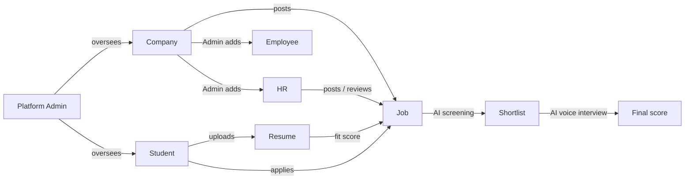
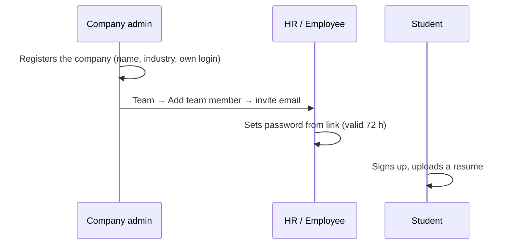

# HireNova — System Flow

How HireNova works from start to finish: who uses it, what each person does, and what the system does
automatically at each step. For setup, code structure and API details, see [README.md](README.md).

---

## 1. The big picture

HireNova connects **companies** that are hiring with **students** looking for jobs. A **Platform Admin**
runs the platform.

In one sentence: **a company registers and posts jobs → students upload a resume and see how well they
fit each job → they apply → the company screens and shortlists with AI → shortlisted students take an
AI voice interview → the company decides.**

---

## 2. Who uses the system

| Person | Shown in the app as | Signs in at | What they do |
| --- | --- | --- | --- |
| Platform owner | **Platform admin** | `/admin` | Dashboard of platform growth and trends; suspends companies; activates / deactivates students |
| Person who registered the company | **Company admin** | `/company` | Everything in their company: jobs, applicants, interviews, and the team |
| Company staff | **HR** | `/company` | What the admin allowed — typically posting jobs, reviewing applicants, interviews |
| Company staff | **Employee** | `/company` | Read only by default — sees jobs and applicants |
| Job seeker | **Student** | `/candidate` | Uploads a resume, checks fit, applies, takes interviews |

Sign up is open: companies at `/auth/register/company`, students at `/auth/register/student`
(`/auth/register` lets you pick). HR and employees can't sign up — their admin adds them. The first
Platform Admin is created with `scripts/create-admin.mjs`.

### Team permissions

The company admin ticks what each HR / employee may do. Picking **HR** or **Employee** fills in a
suggested set, which the admin can change box by box.

| Permission | Allows | HR | Employee |
| --- | --- | :-: | :-: |
| View candidates | See applicants, CVs, fit scores and interview results | ✓ | ✓ |
| Create jobs | Post new jobs | ✓ | |
| Edit jobs | Change job details and settings | ✓ | |
| Close / delete jobs | Close a job, or delete one with no applicants | | |
| Review candidates | Run AI screening, shortlist / reject | ✓ | |
| Configure interviews | AI interviewer, slots and links (also needs *Edit jobs*) | ✓ | |
| Manage team | Add HR / employees and set their permissions | | |

Every member sees all of the company's jobs; permissions decide what they can do. Nobody can change
their own access or the company admin's. Buttons a person can't use are hidden, and the server refuses
the action anyway.

---

## 3. Getting set up

1. **Company registers** at `/auth/register/company`: company name, their own name, work email,
   password, industry (used for the "booming fields" stats), location and website.
2. **Admin builds the team** on **Team**: name, email, HR or Employee, permissions. The person gets an
   email link to set their password (the link is also shown on screen in case email isn't set up).
3. **Students sign up** at `/auth/register/student` and upload a resume on **Profile & resume**. The
   resume fills their profile (reviewed before saving).

Forgot your password? `/auth/forgot-password` emails a reset link valid for 1 hour.

---

## 4. The hiring journey

### Step 1 — Post a job

**Who:** company admin, or anyone with *Create jobs*. **Where:** Jobs → Create a job.

Write a title and a full description, click **Auto-fill details from description** (the AI fills skills,
experience, education, location, work mode, salary…), check the fields, and **Publish job**. The job
appears on every student's **Find jobs** page straight away.

### Step 2 — Students find it and check their fit

**Where:** Find jobs (`/candidate/jobs`).

- Every open job from every active company is listed with a **quick fit score** — skills (50%),
  experience (30%) and education (20%) from the student's resume and profile. No AI call, so it's
  instant. Jobs can be searched, filtered by type and work mode, and sorted by best fit.
- On a job, **Check my fit** runs the same AI screening engine companies use and shows the score,
  skills they have, skills to build, strengths and gaps. This is a private preview — it isn't saved and
  the company never sees it.
- The dashboard shows **Best matches for you**.

### Step 3 — Apply

The student picks a resume (or uploads one right there) and clicks **Apply now**. They can follow the
application under **Applications**. If the job has *auto-advance* on, it is screened immediately.

### Step 4 — Screening and shortlisting

**Who:** admin or anyone with *Review candidates*. **Where:** the job → Applications.

Run AI screening, then filter / sort by score, skills, experience, education and status, and shortlist or
reject (one by one, in bulk, or automatically from the job's minimum score). People with only
*View candidates* see everything but get no action buttons.

### Step 5 — AI interview

Shortlisted students either book a slot or get an instant interview link, depending on the job's
interview settings. The interview is an AI voice conversation (introduction, resume, technical,
job-specific, scenario and behavioural questions, then the student's own questions), with camera / tab
monitoring for presence only.

### Step 6 — Report and decision

The company gets a report: per-question scores, strengths, criteria met / not met, the transcript and a
final score combining CV and interview (weights set per job). The company decides; students see their
status but never the internal final score.

---

## 5. Platform Admin

- **Dashboard** (`/admin/dashboard`): companies, students, jobs, applications, completed interviews and
  team size; growth in the last 30 days; 6-month trends; **booming fields** (industries ranked by jobs
  posted in the last 30 days, with growth vs the 30 days before); most in-demand skills (from open jobs)
  next to the top student skills; most-applied jobs; newest companies.
- **Companies:** add, edit, suspend / reactivate. A suspended company's whole team is logged out and its
  jobs disappear from the students' job board. Nothing is deleted.
- **Students:** search, see applications / interviews / resumes, activate / deactivate.
- **Users:** every login on the platform.

---

## 6. Job lifecycle rules

| Action | Who | Result |
| --- | --- | --- |
| Close a job | *Close / delete jobs* | Students can't apply any more; applications stay |
| Delete a job | *Close / delete jobs* | Only allowed while nobody has applied — otherwise close it |
| Suspend a company | Platform admin | Its jobs vanish from Find jobs; its team can't log in |
| Deactivate a team member | Company admin / *Manage team* | They can't log in; the jobs they created stay |
| Deactivate a student | Platform admin | They can't log in; their applications stay |
